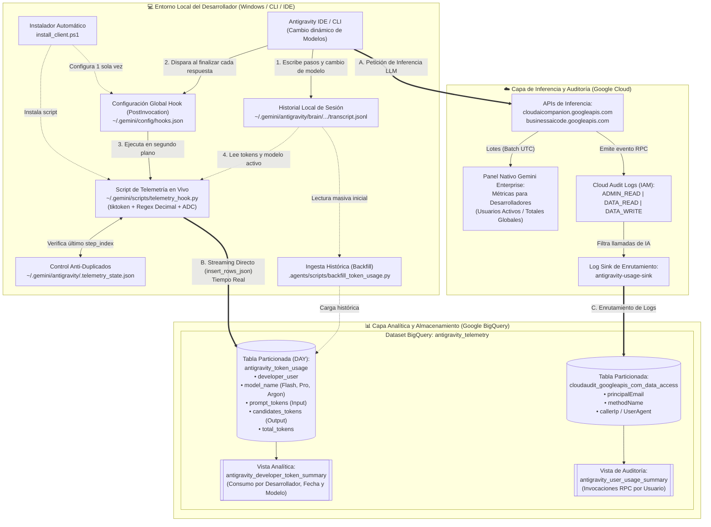

# Guía Técnica Integral: Telemetría de Tokens y Auditoría de Antigravity en BigQuery

Esta guía proporciona la arquitectura y el procedimiento paso a paso para desplegar un sistema de observabilidad y auditoría de **Google Antigravity**. Permite capturar de manera granular el consumo de **tokens de entrada (input)**, **tokens de salida (output)**, **modelo utilizado** y **actividad por desarrollador**, centralizándolo en Google BigQuery para reportes y control de costos.

---

## 1. Arquitectura de la Solución

El sistema opera bajo un modelo híbrido en dos capas independientes (**Telemetría Directa de Cliente** + **Auditoría Cloud Logging**), permitiendo capturar en tiempo real tanto el consumo granular de tokens y modelos como la auditoría de red centralizada en BigQuery:



### ¿Cómo interactúan los componentes en la arquitectura?
1. **Camino A — Inferencia y Métricas Nativas:**
   Antigravity se conecta a las APIs de IA en Google Cloud (`cloudaicompanion.googleapis.com` / `businessaicode.googleapis.com`). Este tráfico alimenta el tablero nativo de *Métricas de herramientas para desarrolladores* en lotes periódicos.
2. **Camino B — Telemetría Granular de Tokens y Modelos en Tiempo Real (`telemetry_hook.py` $\rightarrow$ `BigQuery`):**
   Al finalizar cada turno del agente, el hook global (`~/.gemini/config/hooks.json`) ejecuta `telemetry_hook.py`. Este script lee el historial local (`transcript.jsonl`), detecta dinámicamente cualquier cambio de modelo en el chat, calcula los tokens exactos de entrada y salida con `tiktoken`, y envía la fila directamente a la tabla particionada `antigravity_token_usage` en BigQuery.
3. **Camino C — Auditoría de Seguridad y Red (`Cloud Audit Logs` $\rightarrow$ `antigravity-usage-sink` $\rightarrow$ `BigQuery`):**
   Con los registros `ADMIN_READ`, `DATA_READ` y `DATA_WRITE` activos en IAM, el Sink captura las llamadas de red de las APIs y las enruta automáticamente hacia la tabla `cloudaudit_googleapis_com_data_access` en BigQuery.

---

## 2. Estructura del Repositorio

```text
Antigravity_Telemetry/
├── .agents/
│   ├── hooks.json                      # Configuración del hook a nivel de proyecto
│   └── scripts/
│       ├── telemetry_hook.py           # Hook en tiempo real (captura tokens y modelo tras cada respuesta)
│       └── backfill_token_usage.py     # Script de carga histórica masiva de conversaciones previas
├── deploy_infrastructure.py            # Despliegue automatizado de Dataset, Tabla y Vista en BigQuery
├── install_client.ps1                  # Instalador automático del hook global en Windows para desarrolladores
├── query_reports.py                    # Script de consulta rápida de reportes en consola
├── requirements.txt                    # Dependencias de Python (google-cloud-bigquery, tiktoken)
├── GUIA_INSTALACION_CLIENTE.md         # Guía paso a paso de copia manual de archivos y gcloud por desarrollador
└── README.md                           # Documentación técnica y de arquitectura
```

---

## 3. Requisitos Previos y Variables de Entorno

Defina las variables de entorno según su arquitectura de Google Cloud (pueden apuntar al mismo proyecto o a proyectos separados si el consumo de IA y el almacenamiento en BigQuery están en distintos proyectos):

En **Bash / Linux / macOS**:
```bash
# Proyecto donde se almacenarán las tablas y vistas de BigQuery
export WORKLOAD_PROJECT_ID="<PROYECTO_TELEMETRIA_BQ>"

# Proyecto donde Antigravity ejecuta las consultas de IA
export AI_PROJECT_ID="<PROYECTO_IA>"

# Región de almacenamiento en BigQuery (ej. US, europe-west1)
export BQ_LOCATION="US"

# Nombre del dataset central de observabilidad
export DATASET_NAME="antigravity_telemetry"
```

En **PowerShell** (Windows):
```powershell
$env:WORKLOAD_PROJECT_ID="<PROYECTO_TELEMETRIA_BQ>"
$env:AI_PROJECT_ID="<PROYECTO_IA>"
$env:BQ_LOCATION="US"
$env:DATASET_NAME="antigravity_telemetry"
```

Herramientas requeridas:
* `gcloud` CLI autenticado (`gcloud auth login` y `gcloud auth application-default login`)
* Python 3.10+ con dependencias instaladas:
  ```bash
  pip install -r requirements.txt
  ```

---

## 4. Fase 1: Despliegue de Infraestructura en BigQuery

Puede desplegar toda la infraestructura en BigQuery de forma automática ejecutando el script incluido o manualmente mediante la CLI.

### Opción A: Despliegue Automatizado (Recomendado)
```bash
python deploy_infrastructure.py
```
Este script crea automáticamente:
1. El dataset `antigravity_telemetry` en la ubicación configurada (`US`).
2. La tabla particionada por día `antigravity_token_usage`.
3. La vista analítica consolidada `antigravity_developer_token_summary`.

### Opción B: Creación Manual con `gcloud` y `bq`

#### Paso 4.1: Habilitar APIs en Google Cloud
```bash
gcloud services enable bigquery.googleapis.com logging.googleapis.com --project="${WORKLOAD_PROJECT_ID}"
gcloud services enable logging.googleapis.com businessaicode.googleapis.com cloudaicompanion.googleapis.com --project="${AI_PROJECT_ID}"
```

#### Paso 4.2: Crear el Dataset de Telemetría
```bash
bq --location="${BQ_LOCATION}" mk \
  --dataset \
  --description "Almacén central de logs y métricas de consumo de Antigravity" \
  "${WORKLOAD_PROJECT_ID}:${DATASET_NAME}"
```

#### Paso 4.3: Crear la Tabla de Tokens Particionada por Día
```bash
bq mk --table \
  --time_partitioning_field timestamp \
  --time_partitioning_type DAY \
  --description "Métricas de tokens por interacción, desarrollador y modelo en Antigravity" \
  "${WORKLOAD_PROJECT_ID}:${DATASET_NAME}.antigravity_token_usage" \
  timestamp:TIMESTAMP,usage_date:DATE,developer_user:STRING,conversation_id:STRING,step_index:INTEGER,model_name:STRING,prompt_tokens:INTEGER,candidates_tokens:INTEGER,total_tokens:INTEGER,client_version:STRING,project_id:STRING,workspace_path:STRING
```

> [!NOTE]
> **Esquema de campos de `antigravity_token_usage`:**
> - `timestamp` (`TIMESTAMP`): Marca temporal exacta en formato UTC.
> - `usage_date` (`DATE`): Fecha de particionamiento `YYYY-MM-DD`.
> - `developer_user` (`STRING`): Correo del desarrollador autenticado en `gcloud`.
> - `conversation_id` (`STRING`): UUID único de la sesión de trabajo.
> - `step_index` (`INTEGER`): Índice ordinal del turno o paso dentro de la sesión.
> - `model_name` (`STRING`): Nombre exacto del modelo LLM utilizado (ej. `Gemini 3.8 Flash (High)`, `Gemini 3.1 Pro (High)`, `Gemini 4 Argon (Medium)`).
> - `prompt_tokens` (`INTEGER`): Tokens de entrada consumidos (contexto acumulado + prompt).
> - `candidates_tokens` (`INTEGER`): Tokens de salida generados (respuesta + razonamiento + llamadas a herramientas).
> - `total_tokens` (`INTEGER`): Sumatoria total (`prompt_tokens + candidates_tokens`).
> - `client_version` (`STRING`): Versión del cliente Antigravity.
> - `project_id` (`STRING`): Proyecto GCP activo donde se ejecutó la inferencia de IA.
> - `workspace_path` (`STRING`): Ruta del proyecto local en la máquina del desarrollador.

---

## 5. Fase 2: Configuración de Cloud Audit Logs y Log Sink

Por defecto, Google Cloud desactiva los registros de acceso a datos (`DATA_READ` y `DATA_WRITE`) para evitar costos no deseados. Para auditar las llamadas de red a las APIs de IA, es indispensable habilitarlos en IAM.

### Paso 5.1: Habilitar Cloud Audit Logs (IAM)
En el proyecto donde se ejecutan las consultas de IA (`AI_PROJECT_ID`):
1. En Google Cloud Console, diríjase a **IAM & Admin** > **Audit Logs** (Registros de auditoría).
2. Filtre y seleccione los siguientes dos servicios:
   * **Gemini for Google Cloud API** (`cloudaicompanion.googleapis.com`)
   * **Business AI Code API** (`businessaicode.googleapis.com`)
3. Para ambos servicios, marque las 3 casillas de tipos de registro y guarde los cambios:
   * `[x]` **Lectura de administrador** (`ADMIN_READ`)
   * `[x]` **Lectura de datos** (`DATA_READ`)
   * `[x]` **Escritura de datos** (`DATA_WRITE`)

### Paso 5.2: Crear el Cloud Logging Sink hacia BigQuery
Ejecute el siguiente comando para crear el sink `antigravity-usage-sink` que enruta los eventos hacia BigQuery:

```bash
gcloud logging sinks create antigravity-usage-sink \
  "bigquery.googleapis.com/projects/${WORKLOAD_PROJECT_ID}/datasets/${DATASET_NAME}" \
  --project="${AI_PROJECT_ID}" \
  --log-filter='protoPayload.serviceName="businessaicode.googleapis.com" OR protoPayload.serviceName="cloudaicompanion.googleapis.com" OR resource.type="businessaicode.googleapis.com/BAICInstance" OR logName:"businessaicode.googleapis.com"' \
  --use-partitioned-tables
```

### Paso 5.3: Asignar Permisos IAM a la Cuenta de Servicio del Sink
Al crear el sink, Cloud Logging genera una identidad de escritura (`writerIdentity`). Otorgue permisos de edición sobre el dataset en BigQuery:

```bash
# 1. Obtener la cuenta de servicio generada por el sink
WRITER_SA=$(gcloud logging sinks describe antigravity-usage-sink \
  --project="${AI_PROJECT_ID}" \
  --format='value(writerIdentity)')

# 2. Otorgar rol de Editor de Datos de BigQuery
gcloud projects add-iam-policy-binding "${WORKLOAD_PROJECT_ID}" \
  --member="${WRITER_SA}" \
  --role="roles/bigquery.dataEditor"
```

---

## 6. Fase 3: Instalación del Hook en Equipos de Desarrolladores

El hook `PostInvocation` se ejecuta automáticamente al terminar cada respuesta del agente en Antigravity, leyendo el historial local (`transcript.jsonl`), detectando cambios dinámicos de modelo y enviando las métricas por streaming a BigQuery.

### Opción A: Instalación Global Automática en Windows (Recomendado)
Ejecute el instalador PowerShell incluido en la raíz del proyecto:

```powershell
.\install_client.ps1
```
El instalador realiza automáticamente:
1. Instalación de dependencias (`google-cloud-bigquery`, `tiktoken`).
2. Copia de `.agents/scripts/telemetry_hook.py` a `~/.gemini/scripts/telemetry_hook.py`.
3. Creación del archivo global `~/.gemini/config/hooks.json` para que aplique a **todos** los proyectos del desarrollador.
4. Verificación de credenciales ADC (`gcloud auth application-default login`).

### Opción B: Detalle Técnico de `telemetry_hook.py`
El script incluido en `.agents/scripts/telemetry_hook.py` incorpora:
* **Detección exacta de cambios de modelo con decimales y paréntesis:** Utiliza la expresión regular `r"Model Selection(?:`|\s)*from\s+.*?\s+to\s+(.*?)\.(?:\s+No need|\s+If reporting|\n|</USER_SETTINGS_CHANGE>|$)"` para capturar nombres como `Gemini 3.7 Flash (Medium)`, `Gemini 3.1 Pro (Low)` o `Gemini 4 Argon (Medium)` sin truncarlos en el punto decimal.
* **Detección dinámica del proyecto de IA (`get_active_ai_project()`):** Registra en el campo `project_id` el proyecto de IA activo en el entorno del desarrollador, enviando siempre las filas al dataset central en `WORKLOAD_PROJECT_ID`.
* **Control de estado local (`.telemetry_state.json`):** Registra el último `step_index` enviado por cada `conversation_id` para evitar duplicados.

---

## 7. Fase 4: Ingesta Histórica (Backfill de Sesiones Previas)

Para procesar y cargar en BigQuery todas las conversaciones históricas almacenadas localmente antes de la instalación del hook:

```bash
python .agents/scripts/backfill_token_usage.py
```

El script escanea todos los archivos `~/.gemini/antigravity/brain/*/.system_generated/logs/transcript.jsonl`, reconstruye los cambios de modelo turno por turno, contabiliza los tokens de entrada y salida, e inserta los registros en lotes de 250 filas.

---

## 8. Fase 5: Vistas Analíticas y Consultas de Reporte

### Ejecución Rápida de Reportes en Consola
Puede consultar en cualquier momento el resumen de consumo ejecutando:
```bash
python query_reports.py
```

### Vista 1: `antigravity_developer_token_summary` (Tokens y Modelos)
```sql
CREATE OR REPLACE VIEW `<PROYECTO_TELEMETRIA_BQ>.antigravity_telemetry.antigravity_developer_token_summary` AS
SELECT
  usage_date,
  developer_user,
  model_name,
  SUM(prompt_tokens) AS input_tokens,
  SUM(candidates_tokens) AS output_tokens,
  SUM(total_tokens) AS total_tokens,
  COUNT(1) AS total_interactions,
  COUNT(DISTINCT conversation_id) AS active_conversations
FROM
  `<PROYECTO_TELEMETRIA_BQ>.antigravity_telemetry.antigravity_token_usage`
GROUP BY
  usage_date,
  developer_user,
  model_name;
```

### Vista 2: `antigravity_user_usage_summary` (Auditoría de Red / Cloud Logging)
```sql
CREATE OR REPLACE VIEW `<PROYECTO_TELEMETRIA_BQ>.antigravity_telemetry.antigravity_user_usage_summary` AS
SELECT
  DATE(timestamp) AS usage_date,
  protopayload_auditlog.authenticationInfo.principalEmail AS user_email,
  protopayload_auditlog.methodName AS api_method,
  COUNT(1) AS total_requests,
  MIN(timestamp) AS session_start,
  MAX(timestamp) AS session_end,
  ANY_VALUE(protopayload_auditlog.requestMetadata.callerSuppliedUserAgent) AS client_version
FROM
  `<PROYECTO_TELEMETRIA_BQ>.antigravity_telemetry.cloudaudit_googleapis_com_data_access`
WHERE
  protopayload_auditlog.serviceName IN ('businessaicode.googleapis.com', 'cloudaicompanion.googleapis.com')
GROUP BY
  usage_date,
  user_email,
  api_method;
```

### Consultas Útiles para Looker Studio / BigQuery

#### 1. Consolidado General por Desarrollador y Modelo
```sql
SELECT
  developer_user,
  model_name,
  SUM(input_tokens) AS grand_input_tokens,
  SUM(output_tokens) AS grand_output_tokens,
  SUM(total_tokens) AS grand_total_tokens,
  SUM(total_interactions) AS grand_interactions
FROM
  `<PROYECTO_TELEMETRIA_BQ>.antigravity_telemetry.antigravity_developer_token_summary`
GROUP BY
  developer_user,
  model_name
ORDER BY
  grand_total_tokens DESC;
```

#### 2. Consumo Diario (Últimos 30 días)
```sql
SELECT
  usage_date,
  developer_user,
  model_name,
  input_tokens,
  output_tokens,
  total_tokens,
  total_interactions
FROM
  `<PROYECTO_TELEMETRIA_BQ>.antigravity_telemetry.antigravity_developer_token_summary`
WHERE
  usage_date >= DATE_SUB(CURRENT_DATE(), INTERVAL 30 DAY)
ORDER BY
  usage_date DESC,
  total_tokens DESC;
```

---

## 9. Guía de Solución de Problemas (Troubleshooting)

### A. La tabla `cloudaudit_googleapis_com_data_access` no aparece en BigQuery
* **Causa:** BigQuery solo crea la tabla de forma automática cuando recibe el primer evento que coincide con el filtro del Sink, y requiere que los **Audit Logs** (`DATA_READ`, `DATA_WRITE`) estén activos en IAM para `cloudaicompanion.googleapis.com` y `businessaicode.googleapis.com`.
* **Nota:** La tabla `antigravity_token_usage` funciona de manera 100% independiente a través del hook local (`telemetry_hook.py`), por lo que el registro de tokens y modelos no se detiene aunque el Sink aún no haya recibido eventos.

### B. Diferencia en las gráficas del panel nativo "Métricas para desarrolladores" en GCP
* **Causa:** El panel nativo de Google Cloud agrupa métricas en lotes periódicos con corte en horario UTC y solo contabiliza el tráfico hacia el proyecto donde se envió la inferencia (`AI_PROJECT_ID`). Si el desarrollador cambia de proyecto activo o si el corte diario UTC inicia un nuevo día, el gráfico diario puede mostrarse en cero temporalmente.

### C. Error BigQuery: `UPDATE or DELETE statement would affect rows in the streaming buffer`
* **Causa:** BigQuery no permite sentencias `UPDATE` o `DELETE` sobre filas recién insertadas por streaming hasta que se consolidan (30 a 90 minutos).
* **Solución:** Si necesita limpiar y recargar la tabla durante pruebas, elimine y vuelva a crear la tabla ejecutando `python deploy_infrastructure.py`.

### D. Permisos IAM de los Desarrolladores
* **Causa:** El hook local no logra insertar filas en BigQuery.
* **Solución:** Verifique que el usuario autenticado en `gcloud auth application-default login` cuente con el rol `roles/bigquery.dataEditor` sobre el dataset `antigravity_telemetry`.

