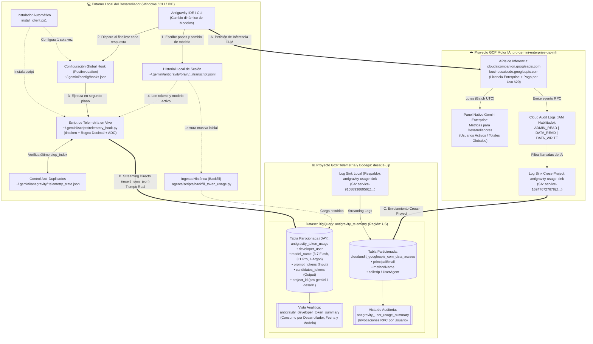

# Guía Técnica Integral: Telemetría de Tokens y Auditoría de Antigravity en BigQuery

Esta guía proporciona la arquitectura y el procedimiento paso a paso para desplegar un sistema de observabilidad y auditoría de **Google Antigravity**. Permite capturar de manera granular el consumo de **tokens de entrada (input)**, **tokens de salida (output)**, **modelo utilizado** y **actividad por desarrollador**, centralizándolo en Google BigQuery para reportes y control de costos.

---

## 1. Arquitectura Final de la Solución (Cross-Project)

El sistema opera bajo un modelo híbrido **Cross-Project** en dos capas independientes (Telemetría Directa de Cliente + Auditoría Cloud Logging), separando el proyecto de licenciamiento/inferencia de IA (`pro-gemini-enterprise-uip-mh`) del proyecto central de almacenamiento analítico en BigQuery (`desa01-uip`):



### ¿Cómo interactúan los componentes en la arquitectura final?
1. **Camino A — Inferencia y Licenciamiento (`pro-gemini-enterprise-uip-mh`):**
   Antigravity se conecta al proyecto `pro-gemini-enterprise-uip-mh` donde consume la licencia de Gemini Enterprise y el presupuesto de pago por uso (\$20). Este tráfico alimenta el tablero nativo de *Métricas de herramientas para desarrolladores* de ese proyecto.
2. **Camino B — Telemetría Granular de Tokens y Modelos en Tiempo Real (`telemetry_hook.py` $\rightarrow$ `desa01-uip`):**
   Al finalizar cada turno del agente, el hook global (`~/.gemini/config/hooks.json`) ejecuta `telemetry_hook.py`. Este script lee el historial local (`transcript.jsonl`), detecta dinámicamente cualquier cambio de modelo en el chat (`Gemini 3.7 Flash`, `Gemini 3.1 Pro`, `Gemini 3.6 Flash`, `Gemini 4 Argon`), calcula los tokens exactos de entrada y salida con `tiktoken`, detecta el proyecto activo (`pro-gemini-enterprise-uip-mh`) y envía la fila directamente a la tabla `desa01-uip.antigravity_telemetry.antigravity_token_usage`.
3. **Camino C — Auditoría de Seguridad y Red (`Cloud Audit Logs` $\rightarrow$ `antigravity-usage-sink` $\rightarrow$ `desa01-uip`):**
   Con los registros `ADMIN_READ`, `DATA_READ` y `DATA_WRITE` activos en ambos proyectos, los Sinks enrutan las llamadas de red de las APIs `cloudaicompanion.googleapis.com` y `businessaicode.googleapis.com` hacia el dataset `antigravity_telemetry` en `desa01-uip`.

---

## 2. Requisitos Previos y Variables de Entorno

Defina las variables del entorno en su terminal:

```bash
# Proyecto donde se almacenarán las tablas y vistas de BigQuery
export WORKLOAD_PROJECT_ID="desa01-uip"

# Proyecto donde Antigravity ejecuta las consultas de IA (donde está configurado el CLI)
export AI_PROJECT_ID="desa01-uip"

# Región de almacenamiento en BigQuery (ej. US, europe-west1)
export BQ_LOCATION="US"

# Nombre del dataset central de observabilidad
export DATASET_NAME="antigravity_telemetry"
```

En **PowerShell** (Windows):
```powershell
$env:WORKLOAD_PROJECT_ID="desa01-uip"
$env:AI_PROJECT_ID="desa01-uip"
$env:BQ_LOCATION="US"
$env:DATASET_NAME="antigravity_telemetry"
```

Asegúrese de contar con las herramientas instaladas y autenticadas:
* `gcloud` CLI (`gcloud auth login` y `gcloud auth application-default login`)
* `bq` CLI
* Python 3.10+ con librerías: `pip install google-cloud-bigquery tiktoken`

---

## 3. Fase 1: Creación del Dataset e Infraestructura BigQuery

### Paso 3.1: Habilitar APIs en Google Cloud
```bash
gcloud services enable bigquery.googleapis.com logging.googleapis.com --project="${WORKLOAD_PROJECT_ID}"
gcloud services enable logging.googleapis.com businessaicode.googleapis.com --project="${AI_PROJECT_ID}"
```

### Paso 3.2: Crear el Dataset de Telemetría
```bash
bq --location="${BQ_LOCATION}" mk \
  --dataset \
  --description "Almacén central de logs y métricas de consumo de Antigravity" \
  "${WORKLOAD_PROJECT_ID}:${DATASET_NAME}"
```

### Paso 3.3: Crear la Tabla de Tokens Particionada por Día
Cree la tabla concreta `antigravity_token_usage`:

```bash
bq mk --table \
  --time_partitioning_field timestamp \
  --time_partitioning_type DAY \
  --description "Métricas de tokens por interacción, desarrollador y modelo en Antigravity" \
  "${WORKLOAD_PROJECT_ID}:${DATASET_NAME}.antigravity_token_usage" \
  timestamp:TIMESTAMP,usage_date:DATE,developer_user:STRING,conversation_id:STRING,step_index:INTEGER,model_name:STRING,prompt_tokens:INTEGER,candidates_tokens:INTEGER,total_tokens:INTEGER,client_version:STRING,project_id:STRING,workspace_path:STRING
```

> [!NOTE]
> Esquema de campos:
> - `timestamp` (TIMESTAMP): Marca temporal exacta en formato UTC.
> - `usage_date` (DATE): Fecha de particionamiento `YYYY-MM-DD`.
> - `developer_user` (STRING): Correo del desarrollador que ejecutó la consulta.
> - `conversation_id` (STRING): UUID único de la sesión de trabajo.
> - `step_index` (INTEGER): Índice ordinal del turno o paso dentro de la sesión.
> - `model_name` (STRING): Nombre exacto del modelo LLM utilizado.
> - `prompt_tokens` (INTEGER): Tokens de entrada consumidos (contexto + prompt).
> - `candidates_tokens` (INTEGER): Tokens de salida generados (respuestas + pensamiento).
> - `total_tokens` (INTEGER): Sumatoria total (`prompt_tokens + candidates_tokens`).
> - `client_version` (STRING): Versión de la herramienta Antigravity (ej. `antigravity/cli/1.2.14`).
> - `project_id` (STRING): Proyecto GCP destino de la inferencia.
> - `workspace_path` (STRING): Ruta de trabajo local en la máquina del desarrollador.

---

## 4. Fase 2: Configuración del Cloud Logging Sink

El Log Sink enruta los eventos de auditoría desde el proyecto de IA (`AI_PROJECT_ID`) hacia el dataset en el proyecto de telemetría (`WORKLOAD_PROJECT_ID`).

### Paso 4.1: Crear el Sink Cross-Project
Ejecute el comando para crear el sink `antigravity-usage-sink`:

```bash
gcloud logging sinks create antigravity-usage-sink \
  "bigquery.googleapis.com/projects/${WORKLOAD_PROJECT_ID}/datasets/${DATASET_NAME}" \
  --project="${AI_PROJECT_ID}" \
  --log-filter='protoPayload.serviceName="businessaicode.googleapis.com" OR protoPayload.serviceName="cloudaicompanion.googleapis.com" OR resource.type="businessaicode.googleapis.com/BAICInstance" OR logName:"businessaicode.googleapis.com"' \
  --use-partitioned-tables
```

### Paso 4.2: Asignar Permisos IAM a la Service Account del Sink
Al crear el sink, Cloud Logging genera una cuenta de servicio (`writerIdentity`). Obtenla y asígnale el rol `roles/bigquery.dataEditor`:

```bash
# 1. Obtener la identidad del escritor del sink
WRITER_SA=$(gcloud logging sinks describe antigravity-usage-sink \
  --project="${AI_PROJECT_ID}" \
  --format='value(writerIdentity)')

echo "Writer Identity: ${WRITER_SA}"

# 2. Otorgar permisos de escritura sobre el proyecto de telemetría
gcloud projects add-iam-policy-binding "${WORKLOAD_PROJECT_ID}" \
  --member="${WRITER_SA}" \
  --role="roles/bigquery.dataEditor"
```

*(Opcional: Si el CLI también opera directamente sobre `WORKLOAD_PROJECT_ID`, repita la creación de un sink local en dicho proyecto).*

> [!TIP]
> Tan pronto como los desarrolladores ejecuten consultas, Cloud Logging creará automáticamente la tabla particionada `${WORKLOAD_PROJECT_ID}.${DATASET_NAME}.cloudaudit_googleapis_com_data_access`.

---

## 5. Fase 3: Despliegue del Hook de Telemetría en Antigravity

El hook se ejecuta de forma transparente en la máquina de cada desarrollador tras cada turno del modelo (`PostInvocation`), garantizando la captura de tokens sin interferir en el flujo de trabajo.

### Paso 5.1: Crear el Script de Ingesta (`telemetry_hook.py`)
Guarde este archivo en el repositorio en la ruta `.agents/scripts/telemetry_hook.py`:

```python
#!/usr/bin/env python3
"""
Antigravity Telemetry Hook: Captura tokens por interacción y envía streaming a BigQuery.
"""
import sys
import json
import os
import re
import datetime
import subprocess

def get_developer_user():
    try:
        user = subprocess.check_output(
            ["gcloud", "config", "get-value", "account"],
            stderr=subprocess.DEVNULL,
            text=True
        ).strip()
        if user and "@" in user:
            return user
    except Exception:
        pass
    return os.environ.get("USER", os.environ.get("USERNAME", "unknown_developer"))

def get_default_model():
    try:
        settings_path = os.path.expanduser("~/.gemini/antigravity-cli/settings.json")
        if os.path.exists(settings_path):
            with open(settings_path, "r", encoding="utf-8") as f:
                return json.load(f).get("model", "Gemini 3.8 Flash (High)")
    except Exception:
        pass
    return "Gemini 3.8 Flash (High)"

def main():
    response_payload = {"injectSteps": []}
    
    try:
        input_data = sys.stdin.read()
        if not input_data.strip():
            return
            
        data = json.loads(input_data)
        conv_id = data.get("conversationId")
        transcript_path = data.get("transcriptPath")
        model_name = data.get("modelName") or get_default_model()
        workspace_paths = data.get("workspacePaths", [])
        workspace_path = workspace_paths[0] if workspace_paths else os.getcwd()
        
        if not transcript_path or not os.path.exists(transcript_path):
            return
            
        import tiktoken
        from google.cloud import bigquery
        
        enc = tiktoken.get_encoding("cl100k_base")
        
        # Archivo local de control de estado para evitar duplicados
        state_dir = os.path.expanduser("~/.gemini/antigravity-cli")
        os.makedirs(state_dir, exist_ok=True)
        state_file = os.path.join(state_dir, ".telemetry_state.json")
        state = {}
        if os.path.exists(state_file):
            try:
                with open(state_file, "r", encoding="utf-8") as f:
                    state = json.load(f)
            except Exception:
                state = {}
                
        last_processed_step = state.get(conv_id, -1)
        
        rows_to_insert = []
        running_prompt_tokens = 500  # Estimación base del prompt de sistema
        max_step_seen = last_processed_step
        
        with open(transcript_path, "r", encoding="utf-8") as f:
            for line in f:
                if not line.strip():
                    continue
                try:
                    step = json.loads(line)
                except Exception:
                    continue
                    
                stype = step.get("type")
                source = step.get("source")
                content = step.get("content") or ""
                thinking = step.get("thinking") or ""
                tool_calls = step.get("tool_calls") or []
                step_idx = step.get("step_index", 0)
                created_at = step.get("created_at") or datetime.datetime.now(datetime.timezone.utc).isoformat()
                
                # Detectar cambios explícitos de modelo durante la conversación
                if "<USER_SETTINGS_CHANGE>" in content and "Model Selection" in content:
                    m = re.search(r"Model Selection` from \S+ to (.*?)\.\s+(?:No need|If reporting|$)", content)
                    if m:
                        model_name = m.group(1).strip()
                
                if stype in ["USER_INPUT", "GENERIC"] or source in ["USER_EXPLICIT", "SYSTEM"]:
                    running_prompt_tokens += len(enc.encode(str(content)))
                elif stype == "PLANNER_RESPONSE" or source == "MODEL":
                    cand_text = str(content) + str(thinking) + (json.dumps(tool_calls) if tool_calls else "")
                    c_tok = len(enc.encode(cand_text)) if cand_text else 0
                    
                    if step_idx > last_processed_step:
                        usage_date = created_at[:10] if len(created_at) >= 10 else datetime.date.today().isoformat()
                        p_tok = running_prompt_tokens
                        rows_to_insert.append({
                            "timestamp": created_at,
                            "usage_date": usage_date,
                            "developer_user": get_developer_user(),
                            "conversation_id": conv_id,
                            "step_index": step_idx,
                            "model_name": model_name,
                            "prompt_tokens": p_tok,
                            "candidates_tokens": c_tok,
                            "total_tokens": p_tok + c_tok,
                            "client_version": "antigravity/cli/1.2.14",
                            "project_id": os.environ.get("AI_PROJECT_ID", "desa01-uip"),
                            "workspace_path": workspace_path
                        })
                        if step_idx > max_step_seen:
                            max_step_seen = step_idx
                            
                    running_prompt_tokens += c_tok
                    
        if rows_to_insert:
            client = bigquery.Client(project=os.environ.get("WORKLOAD_PROJECT_ID", "desa01-uip"))
            table_id = f"{client.project}.antigravity_telemetry.antigravity_token_usage"
            client.insert_rows_json(table_id, rows_to_insert)
            
            state[conv_id] = max_step_seen
            with open(state_file, "w", encoding="utf-8") as f:
                json.dump(state, f)
                
    except Exception as e:
        err_log = os.path.expanduser("~/.gemini/antigravity-cli/telemetry_hook.log")
        with open(err_log, "a", encoding="utf-8") as f:
            f.write(f"[{datetime.datetime.now().isoformat()}] Error: {str(e)}\n")
    finally:
        print(json.dumps(response_payload))

if __name__ == "__main__":
    main()
```

### Paso 5.2: Configuración del Hook (`hooks.json`)
Cree el archivo `.agents/hooks.json` en la raíz de su proyecto (y opcionalmente en `~/.gemini/config/hooks.json` para cobertura global en la máquina):

```json
{
  "antigravity-token-telemetry": {
    "enabled": true,
    "PostInvocation": [
      {
        "type": "command",
        "command": "python .agents/scripts/telemetry_hook.py",
        "timeout": 30
      }
    ]
  }
}
```

---

## 6. Fase 4: Ingesta Histórica (Backfill de Sesiones Previas)

Para cargar todas las conversaciones históricas ya ejecutadas por los desarrolladores antes de habilitar el hook:

### Paso 6.1: Script de Backfill (`backfill_token_usage.py`)
Guarde este archivo en `.agents/scripts/backfill_token_usage.py`:

```python
#!/usr/bin/env python3
"""
Backfill histórico de conversaciones locales de Antigravity hacia BigQuery.
"""
import os
import glob
import json
import re
import datetime
import subprocess
import tiktoken
from google.cloud import bigquery

def get_developer_user():
    try:
        user = subprocess.check_output(
            ["gcloud", "config", "get-value", "account"],
            stderr=subprocess.DEVNULL,
            text=True
        ).strip()
        if user and "@" in user:
            return user
    except Exception:
        pass
    return os.environ.get("USER", os.environ.get("USERNAME", "unknown_developer"))

def get_default_model():
    try:
        settings_path = os.path.expanduser("~/.gemini/antigravity-cli/settings.json")
        if os.path.exists(settings_path):
            with open(settings_path, "r", encoding="utf-8") as f:
                return json.load(f).get("model", "Gemini 3.8 Flash (High)")
    except Exception:
        pass
    return "Gemini 3.8 Flash (High)"

def backfill():
    project_id = os.environ.get("WORKLOAD_PROJECT_ID", "desa01-uip")
    client = bigquery.Client(project=project_id)
    table_id = f"{project_id}.antigravity_telemetry.antigravity_token_usage"
    
    enc = tiktoken.get_encoding("cl100k_base")
    conv_dir = os.path.expanduser("~/.gemini/antigravity/brain")
    if not os.path.exists(conv_dir):
        conv_dir = os.path.expanduser("~/.gemini/antigravity-cli/brain")
        
    transcripts = sorted(glob.glob(f"{conv_dir}/*/.system_generated/logs/transcript.jsonl"))
    
    print(f"Descubiertos {len(transcripts)} historiales de conversación.")
    dev_user = get_developer_user()
    default_model = get_default_model()
    print(f"Desarrollador asignado: {dev_user}")
    print(f"Modelo por defecto: {default_model}")
    
    all_rows = []
    total_prompt_tokens = 0
    total_candidate_tokens = 0
    
    for t_path in transcripts:
        # Extraer el ID de conversación del directorio padre
        parts = os.path.normpath(t_path).split(os.sep)
        conv_id = parts[-4] if len(parts) >= 4 else "unknown_conversation"
        current_model = default_model
        running_prompt_tokens = 500
        
        try:
            with open(t_path, "r", encoding="utf-8") as f:
                for line in f:
                    if not line.strip():
                        continue
                    try:
                        step = json.loads(line)
                    except Exception:
                        continue
                        
                    stype = step.get("type")
                    source = step.get("source")
                    content = step.get("content") or ""
                    thinking = step.get("thinking") or ""
                    tool_calls = step.get("tool_calls") or []
                    step_idx = step.get("step_index", 0)
                    created_at = step.get("created_at") or datetime.datetime.now(datetime.timezone.utc).isoformat()
                    
                    if "<USER_SETTINGS_CHANGE>" in content and "Model Selection" in content:
                        m = re.search(r"Model Selection` from \S+ to (.*?)\.\s+(?:No need|If reporting|$)", content)
                        if m:
                            current_model = m.group(1).strip()
                            
                    if stype in ["USER_INPUT", "GENERIC"] or source in ["USER_EXPLICIT", "SYSTEM"]:
                        running_prompt_tokens += len(enc.encode(str(content)))
                    elif stype == "PLANNER_RESPONSE" or source == "MODEL":
                        cand_text = str(content) + str(thinking) + (json.dumps(tool_calls) if tool_calls else "")
                        c_tok = len(enc.encode(cand_text)) if cand_text else 0
                        p_tok = running_prompt_tokens
                        
                        usage_date = created_at[:10] if len(created_at) >= 10 else datetime.date.today().isoformat()
                        
                        all_rows.append({
                            "timestamp": created_at,
                            "usage_date": usage_date,
                            "developer_user": dev_user,
                            "conversation_id": conv_id,
                            "step_index": step_idx,
                            "model_name": current_model,
                            "prompt_tokens": p_tok,
                            "candidates_tokens": c_tok,
                            "total_tokens": p_tok + c_tok,
                            "client_version": "antigravity/cli/1.2.14",
                            "project_id": os.environ.get("AI_PROJECT_ID", "desa01-uip"),
                            "workspace_path": os.getcwd()
                        })
                        
                        total_prompt_tokens += p_tok
                        total_candidate_tokens += c_tok
                        running_prompt_tokens += c_tok
        except Exception as e:
            print(f"Error en {t_path}: {e}")

    print(f"\nTotal interacciones extraídas: {len(all_rows)}")
    print(f"Tokens de Input: {total_prompt_tokens:,}")
    print(f"Tokens de Output: {total_candidate_tokens:,}")
    print(f"Total Tokens: {total_prompt_tokens + total_candidate_tokens:,}")
    
    batch_size = 250
    inserted = 0
    for i in range(0, len(all_rows), batch_size):
        batch = all_rows[i:i+batch_size]
        err = client.insert_rows_json(table_id, batch)
        if err:
            print(f"Error en lote {i}: {err}")
        else:
            inserted += len(batch)
            print(f"Cargado lote {i // batch_size + 1}/{(len(all_rows) + batch_size - 1) // batch_size} ({inserted}/{len(all_rows)} filas)")
            
    print(f"\n✓ Backfill completado exitosamente: {inserted} filas insertadas en {table_id}")

if __name__ == "__main__":
    backfill()
```

### Paso 6.2: Ejecución del Backfill
```bash
python .agents/scripts/backfill_token_usage.py
```

---

## 7. Fase 5: Creación de Vistas Analíticas en BigQuery

### Paso 7.1: Vista `antigravity_developer_token_summary` (Tokens y Modelo)
Esta vista responde exactamente a la meta de identificar cuántos tokens de input y output tiene cada desarrollador y qué modelo utilizó:

```sql
CREATE OR REPLACE VIEW `desa01-uip.antigravity_telemetry.antigravity_developer_token_summary` AS
SELECT
  usage_date,
  developer_user,
  model_name,
  SUM(prompt_tokens) AS input_tokens,
  SUM(candidates_tokens) AS output_tokens,
  SUM(total_tokens) AS total_tokens,
  COUNT(1) AS total_interactions,
  COUNT(DISTINCT conversation_id) AS active_conversations
FROM
  `desa01-uip.antigravity_telemetry.antigravity_token_usage`
GROUP BY
  usage_date,
  developer_user,
  model_name;
```

### Paso 7.2: Vista `antigravity_user_usage_summary` (Auditoría de Invocaciones)
Esta vista consolida las peticiones recibidas por el Cloud Audit Sink:

```sql
CREATE OR REPLACE VIEW `desa01-uip.antigravity_telemetry.antigravity_user_usage_summary` AS
SELECT
  DATE(timestamp) AS usage_date,
  protopayload_auditlog.authenticationInfo.principalEmail AS user_email,
  protopayload_auditlog.methodName AS api_method,
  COUNT(1) AS total_requests,
  MIN(timestamp) AS session_start,
  MAX(timestamp) AS session_end,
  ANY_VALUE(protopayload_auditlog.requestMetadata.callerSuppliedUserAgent) AS client_version
FROM
  `desa01-uip.antigravity_telemetry.cloudaudit_googleapis_com_data_access`
WHERE
  protopayload_auditlog.serviceName = 'businessaicode.googleapis.com'
GROUP BY
  usage_date,
  user_email,
  api_method;
```

---

## 8. Fase 6: Consultas de Validación y Reportes

### 1. Consolidado General por Desarrollador y Modelo:
```sql
SELECT
  developer_user,
  model_name,
  SUM(input_tokens) AS grand_input_tokens,
  SUM(output_tokens) AS grand_output_tokens,
  SUM(total_tokens) AS grand_total_tokens,
  SUM(total_interactions) AS grand_interactions
FROM
  `desa01-uip.antigravity_telemetry.antigravity_developer_token_summary`
GROUP BY
  developer_user,
  model_name
ORDER BY
  grand_total_tokens DESC;
```

### 2. Consumo Diario (Últimos 30 días):
```sql
SELECT
  usage_date,
  developer_user,
  model_name,
  input_tokens,
  output_tokens,
  total_tokens,
  total_interactions
FROM
  `desa01-uip.antigravity_telemetry.antigravity_developer_token_summary`
WHERE
  usage_date >= DATE_SUB(CURRENT_DATE(), INTERVAL 30 DAY)
ORDER BY
  usage_date DESC,
  total_tokens DESC;
```

### 3. Cruce de Auditoría (Llamadas API vs Tokens Generados):
```sql
WITH rpc_counts AS (
  SELECT
    usage_date,
    user_email,
    SUM(total_requests) AS api_requests
  FROM
    `desa01-uip.antigravity_telemetry.antigravity_user_usage_summary`
  GROUP BY usage_date, user_email
),
token_counts AS (
  SELECT
    usage_date,
    developer_user,
    SUM(input_tokens) AS input_tokens,
    SUM(output_tokens) AS output_tokens,
    SUM(total_tokens) AS total_tokens
  FROM
    `desa01-uip.antigravity_telemetry.antigravity_developer_token_summary`
  GROUP BY usage_date, developer_user
)
SELECT
  COALESCE(t.usage_date, r.usage_date) AS date,
  COALESCE(t.developer_user, r.user_email) AS developer,
  r.api_requests,
  t.input_tokens,
  t.output_tokens,
  t.total_tokens
FROM token_counts t
FULL OUTER JOIN rpc_counts r
  ON t.usage_date = r.usage_date AND t.developer_user = r.user_email
ORDER BY date DESC;
```

---

## 9. Guía de Solución de Problemas (Troubleshooting)

### A. Error BigQuery: `Views cannot be queried through prefix`
* **Causa:** Ocurre si ejecuta consultas wildcard (`FROM dataset.*`) sobre un dataset que contiene vistas lógicas.
* **Solución:** Consulte directamente la tabla (`FROM dataset.antigravity_token_usage`) o consulte la vista analítica (`FROM dataset.antigravity_developer_token_summary`).

### B. Error BigQuery: `404 Table ... not found on insertAll`
* **Causa:** Al crear una tabla nueva en BigQuery mediante DDL o `bq mk`, los endpoints de streaming buffer (`insertAll`) pueden tardar entre 30 y 60 segundos en propagar los metadatos.
* **Solución:** Aguarde un minuto tras la creación de la tabla antes de ejecutar el primer streaming insert.

### C. Error BigQuery: `UPDATE or DELETE statement would affect rows in the streaming buffer`
* **Causa:** BigQuery no permite mutaciones DML (`UPDATE`, `DELETE`) sobre filas que aún residen en el streaming buffer en memoria (tardan entre 30 y 90 minutos en consolidarse a almacenamiento columnar).
* **Solución:** Si necesita reiniciar datos de prueba antes de que se vacíe el buffer, elimine y recree la tabla con `bq rm -f -t` y `bq mk --table`.

### D. Permisos IAM de los Desarrolladores
* **Causa:** Un desarrollador recibe error de inserción al ejecutar Antigravity.
* **Solución:** Asegúrese de que el desarrollador o su grupo cuente con el rol `roles/bigquery.dataEditor` sobre el dataset `${WORKLOAD_PROJECT_ID}:${DATASET_NAME}` y `roles/bigquery.jobUser` sobre el proyecto `${WORKLOAD_PROJECT_ID}`.
